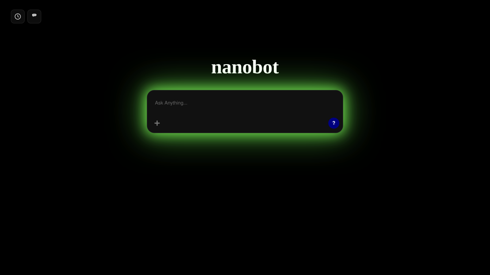

<!-- {Created comprehensive production README with custom source-available license and accurate architecture} [Commented by: Sonic on 10/13/2026 10:35 AM] -->

# nanobot 🕷️

> Open source AI chatbot with Real-Time Web Grounding, Deep Research, Universal File Reading, and Zero-Knowledge Client-Side Encryption.

**Repository:** [https://github.com/anvilgabimpartduckcom/nanobot](https://github.com/anvilgabimpartduckcom/nanobot)

---

<!-- {Updated Interface Preview in README.md with public/preview.png screenshot} [Commented by: Sonic on 10/13/2026 10:41 AM] -->
## 📸 Interface Preview



---

<!-- {Updated README documentation with revised local-only IndexedDB file handling and Cloudflare D1 AI output persistence} [Commented by: Google AI Studio on October 15, 2026 at 9:22 AM] -->
## ✨ Features

- **Bring-Your-Own-Key (BYOK) Model**: Users provide their own OpenRouter and Tavily API keys during registration or within Account settings. Keys are validated for global uniqueness, encrypted, and stored per account.
- **Client-Side Zero-Knowledge Encryption**: Chat transcripts and titles are encrypted in the browser using **Web Crypto AES-GCM (256-bit)** with keys derived via PBKDF2 (100,000 iterations of SHA-256) from the user's password. Stored database records are ciphertext-only; neither the server nor database administrators can read user chats.
- **Tiered Cloud Architecture (Supabase + Cloudflare Worker D1)**: Active sessions and user authentication are managed via Supabase, while chat conversations, message histories, and AI-extracted file outputs are persisted in Cloudflare D1 via a secure Cloudflare Worker backend requiring validated Supabase Bearer tokens.
- **Privacy-First File Handling (IndexedDB + D1 Outputs)**:
  - **Local-Only Original Files**: Raw user files and images are stored exclusively in the user's browser using **IndexedDB**, never uploaded to any cloud storage or external server.
  - **Cloud-Persisted AI Outputs**: Extracted text, structured data summaries, and dynamic Python inspection scripts are safely persisted in Cloudflare D1, making extracted knowledge accessible across devices without exposing original files.
  - **Clear File Status UX**: Clearly distinguishes between locally present original files and cloud-preserved AI outputs when accessing conversations from multiple devices or following browser storage purges.
  - **Cascading Cleanup**: Deleting chats cleans up local IndexedDB blobs and executes cascading deletion of all associated messages and AI outputs in D1 without orphaned records.
- **Tavily Deep Research & URL Web Scraping**:
  - `# <query>`: Initiates fast Mini Deep Research with live source synthesis.
  - `## <query>`: Initiates comprehensive Pro Deep Research with multi-angle reporting.
  - `<Scrap1>URL1</Scrap1> <Scrap2>URL2</Scrap2>`: The AI dynamically scrapes and extracts full webpage markdown directly using Tavily's Extract API.
- **Fluid Token Streaming**: Utilizes a `requestAnimationFrame` token smoothing ticker buffer to deliver smooth reading streams without choppy network packet bursts.
- **Mathematical Typesetting & Code Highlighting**: Full LaTeX math formula parsing (`\[...\]`, `$$...$$`, `\(...\)`, `$..$`) via KaTeX alongside syntax-highlighted code blocks via Highlight.js.
- **Two-Column Settings Suite**:
  - **Account**: Update username, password, hyperlinked OpenRouter/Tavily keys, or delete account.
  - **AI Configuration**: Custom system instructions (Enter saves, Shift+Enter newline) and an "Enable Model Training" toggle (default ON; sends `data_collection: "deny"` when OFF).
  - **MCP Plugins Hub**: Integration hooks for Google Drive, Gmail, Google Docs, Notion, Firecrawl, and Tavily.
  - **About nanobot**: Privacy statement, developer contact (`molecule-sip-sauna@duck.com`), 30-day chat deletion policy, and direct link to official Notion documentation.
- **Incognito Mode (`🕶️` / `☀️`)**: Signed-in users can toggle ephemeral incognito sessions that omit database persistence and automatically opt out of model training data collection.
- **30-Day Auto Purge**: Inactive chats older than 30 days are automatically pruned via client filters and PostgreSQL routines.
- **Crawler Indexing & SEO**: Crawlers are unblocked with rich OpenGraph, Twitter Cards, and Schema.org WebApplication structured data.

---

## 🛠️ Technology Stack

| Layer | Technologies |
| :--- | :--- |
| **Frontend Framework** | React 19, TypeScript, Vite 8 |
| **Styling & Effects** | Tailwind CSS v4, Lucide React, Motion |
| **Cryptography** | Web Crypto API (`window.crypto.subtle`, PBKDF2, AES-GCM 256-bit) |
| **Typography & Parsers** | MarkdownIt, KaTeX, DOMPurify, Highlight.js |
| **Authentication** | Supabase (PostgreSQL, Row Level Security, Auth OTP) |
| **Backend & Persistence** | Cloudflare Workers, Cloudflare D1 SQL Database, Cloudflare R2 |
| **AI Models & Search** | OpenRouter API (`nvidia/nemotron-3-nano-omni-30b-a3b-reasoning`), Tavily Search & Research API |
| **Deployment** | Netlify (SPA build with redirects), Cloudflare Workers |

---

## 📋 Prerequisites

- **Node.js**: Version 18.0.0 or higher
- **npm**: Version 9.0.0 or higher
- A [Supabase](https://supabase.com) project (free or paid)
- A [Netlify](https://netlify.com) account for deployment (optional for local use)

---

## 🚀 Installation & Local Development

1. **Clone the repository:**
   ```bash
   git clone https://github.com/anvilgabimpartduckcom/nanobot.git
   cd nanobot
   ```

2. **Install dependencies:**
   ```bash
   npm install
   ```

3. **Configure environment variables:**
   Copy the example environment file:
   ```bash
   cp .env.example .env
   ```
   Fill in your Supabase credentials (see [Environment Variables](#-environment-variables)).

4. **Start development server:**
   ```bash
   npm run dev
   ```
   Open your browser at `http://localhost:3000`.

5. **Run type checks and linter:**
   ```bash
   npm run lint
   ```

6. **Build for production:**
   ```bash
   npm run build
   ```

---

## ⚙️ Environment Variables

Create a `.env` file in the project root with your project credentials:

```env
# Supabase Project URL (found in Supabase Dashboard -> Project Settings -> API)
VITE_SUPABASE_URL="https://your-project-id.supabase.co"

# Supabase Anonymous/Public API Key (found in Supabase Dashboard -> Project Settings -> API)
VITE_SUPABASE_ANON_KEY="eyJhbGciOi..."
```

> **Security Note:** Never commit `.env` containing live credentials to public version control. Never expose secret keys (such as `SUPABASE_SERVICE_ROLE_KEY`) in frontend code.

---

## 🗄️ Backend & Deployment Setup

### 1. Supabase Setup
1. In your [Supabase Dashboard](https://app.supabase.com), open the **SQL Editor**.
2. Run the migration script located at `supabase/schema.sql` to create:
   - `public.user_profiles` table (with global uniqueness constraints on email, username, OpenRouter key, and Tavily key).
   - `public.chats` table (stores encrypted ciphertexts, IVs, and salts).
   - Row Level Security (RLS) policies.
   - `purge_inactive_chats()` automated 30-day cleanup function.
3. *Free Plan Email Note:* On Supabase free tier plans, custom SMTP email templates are restricted. Supabase will send its default email verification confirmation link, allowing users to verify and complete their profile setup.

<!-- {Added comprehensive Cloudflare Worker and D1 backend persistence setup guide} [Commented by: Google AI Studio on October 14, 2026 at 10:55 AM] -->
### 2. Cloudflare Worker & D1 Database Setup
The Nanobot backend leverages Cloudflare Workers and Cloudflare D1 for serverless, zero-trust chat transcript persistence:
- **Base Endpoint:** `https://nanobot-api.mud-amiable-tweed.workers.dev/` (configurable via `VITE_CLOUDFLARE_WORKER_URL`)
- **Zero-Trust Token Verification:** All `/api/*` endpoints require an `Authorization: Bearer <supabase_access_token>` header. The Cloudflare Worker directly verifies the token with Supabase Auth (`/auth/v1/user`) to securely extract the authenticated `user.id`. Client-supplied user IDs are never trusted.
- **Parameterized D1 Queries:** All SQL statements use prepared statement bindings to prevent SQL injection.

#### Deployment Steps:
1. **Create the D1 Database:**
   ```bash
   cd worker
   npx wrangler d1 create nanobot_db
   ```
   Copy the generated `database_id` into `worker/wrangler.toml`.

<!-- {Updated Cloudflare Worker D1 schema command with nanobot-chat-history and diagnostic testing steps} [Commented by: Google AI Studio on October 15, 2026 at 09:57 AM] -->
2. **Execute the Database Schema:**
   Apply the schema to your existing Cloudflare D1 database:
   ```bash
   cd worker
   npx wrangler d1 execute nanobot-chat-history --remote --file=./schema.sql
   ```
   This creates the `conversations`, `messages`, and `file_outputs` tables with cascading foreign keys (`ON DELETE CASCADE`) and composite indexes.

3. **Configure Worker Secrets:**
   Configure your Supabase credentials securely as encrypted Cloudflare secrets (never commit these to Git or wrangler.toml):
   ```bash
   npx wrangler secret put SUPABASE_URL
   # Enter your Supabase Project URL (e.g., https://your-project.supabase.co)

   npx wrangler secret put SUPABASE_ANON_KEY
   # Enter your Supabase Anon/Public Key (eyJhbGciOi...)
   ```

4. **Deploy the Worker:**
   ```bash
   npx wrangler deploy
   ```

5. **Verify the Deployment & Diagnostics:**
   Visit `https://nanobot-api.mud-amiable-tweed.workers.dev/api/health` in your browser or with curl:
   ```bash
   curl https://nanobot-api.mud-amiable-tweed.workers.dev/api/health
   ```
   You should receive a `200 OK` response confirming:
   - `d1_database_bound: true`
   - `supabase_url_configured: true`
   - `supabase_anon_key_configured: true`
   - `cors_origin: "*"`

6. **Connect to Frontend:**
   Configure your frontend environment variable in `.env` (or Netlify dashboard):
   ```env
   VITE_CLOUDFLARE_WORKER_URL="https://nanobot-api.mud-amiable-tweed.workers.dev"
   ```

### 3. Netlify Deployment
1. Connect your repository to [Netlify](https://app.netlify.com).
2. The provided `netlify.toml` automatically configures:
   - Build Command: `npm run build`
   - Publish Directory: `dist`
   - Single-Page Application (SPA) redirects (`/*` to `/index.html`)
3. Under **Site Configuration -> Environment Variables**, add `VITE_SUPABASE_URL`, `VITE_SUPABASE_ANON_KEY`, and `VITE_CLOUDFLARE_WORKER_URL` (or connect using Netlify's official Supabase integration extension).

---

## 📂 Project Structure

```
nanobot/
├── index.html              # HTML entry point with SEO, KaTeX & Highlight.js CSS
├── metadata.json           # Application identity metadata
├── netlify.toml            # Netlify SPA build and redirect rules
├── package.json            # Node.js dependencies and scripts
├── tsconfig.json           # TypeScript configuration
├── vite.config.ts          # Vite build configuration with Tailwind CSS plugin
├── README.md               # Project documentation
├── LICENSE                 # Custom source-available license
├── worker/                 # Cloudflare Worker backend
│   ├── src/index.ts        # Worker REST API with Supabase token verification, D1 queries & file output endpoints
│   ├── schema.sql          # Cloudflare D1 tables (conversations, messages, file_outputs)
│   └── wrangler.toml       # Cloudflare Wrangler configuration & D1 binding
├── supabase/
│   └── schema.sql          # PostgreSQL tables, RLS policies, and purge functions
└── src/
    ├── main.tsx            # React application mount point
    ├── App.tsx             # Main chat interface, sidebar, incognito, and stream handlers
    ├── index.css           # Tailwind CSS imports, neon aura glow, and scrollbar styles
    ├── components/
    │   ├── AuthModal.tsx   # Two-stage signup and signin modal with uniqueness checks
    │   └── SettingsModal.tsx # Two-column settings: Account, AI Config, Plugins, About
    └── lib/
        ├── crypto.ts       # Web Crypto PBKDF2 key derivation and AES-GCM encryption
        ├── fileReader.ts   # Universal code-driven file analyzer for non-image files with stable fileIds
        ├── indexedDb.ts    # Browser IndexedDB local-only original user file storage & orphaned file cleanup
        ├── markdown.ts     # Markdown, KaTeX math parsing, and Highlight.js styling
        ├── plugins.ts      # MCP plugins registry (Drive, Gmail, Docs, Notion, Firecrawl, Tavily)
        ├── r2.ts           # Cloudflare R2 archive integration utilities
        ├── supabase.ts     # Supabase client with multi-prefix Netlify env var resolution
        ├── tavily.ts       # Tavily search, URL scraping, and # / ## Deep Research runners
        └── workerClient.ts # Cloudflare Worker REST API client with Bearer token authentication
```

---

## 🔒 Security & Privacy

- **Zero-Knowledge Encryption**: Chat content is encrypted locally using the Web Crypto API prior to transmission or persistence. Stored records consist exclusively of encrypted ciphertexts, initialization vectors (IVs), and salts.
- **No Shared Keys**: API keys for OpenRouter and Tavily are supplied directly by each end user and stored in their encrypted account. The administrator does not provide or maintain shared keys for user queries.
- **Client Security**: No private secret keys, master keys, or service-role keys are bundled into frontend assets.

---

## 🤝 Contribution Guidelines

This repository is **source-available for private inspection and study**:
- You are welcome to view, study, evaluate, and privately modify the code for personal, private, or internal use.
- **Prohibited:** Publicly redistributing the original or modified source code, sharing any part or snippet of the code, publishing public forks on GitHub or other platforms, and selling or sublicensing copies without prior explicit written permission obtained via email.
- **Sharing Code:** If ever anyone needs or wishes to share any part or snippet of this code, they must take explicit permission via email from `anvil-gab-impart@duck.com`.

---

## 📜 License

This project is licensed under a **Custom Source-Available Limited Use License**.

- It is **NOT** licensed under MIT, Apache 2.0, GPL, or another permissive open-source license.
- It does **NOT** constitute open-source software under the Open Source Definition.
- Review the complete terms in the [LICENSE](./LICENSE) file.
- **Sharing Requirement:** Sharing any portion of the source code requires prior explicit permission granted via email by the author.

> **Legal Notice:** This custom restrictive license is provided for source-available proprietary protection. Users and project maintainers are advised that custom licenses should be reviewed by a qualified legal professional before commercial publication.

---

<!-- {Updated contact email to anvil-gab-impart@duck.com and code-sharing permission protocol} [Commented by: Google AI Studio on October 15, 2026 at 10:01 AM] -->
## 📬 Contact & Inquiries

For questions, permissions, code-sharing authorizations, developer support, or license inquiries:
- **Permission & License Requests:** `anvil-gab-impart@duck.com`
- **Developer Support:** `molecule-sip-sauna@duck.com` / `anvil-gab-impart@duck.com`
- **Documentation:** [nanobot Docs](https://tropical-chime-8c1.notion.site/nanobot-Docs-3f4b104092f3804792d0c68bca97e821)
- **GitHub Repository:** [https://github.com/anvilgabimpartduckcom/nanobot](https://github.com/anvilgabimpartduckcom/nanobot)
